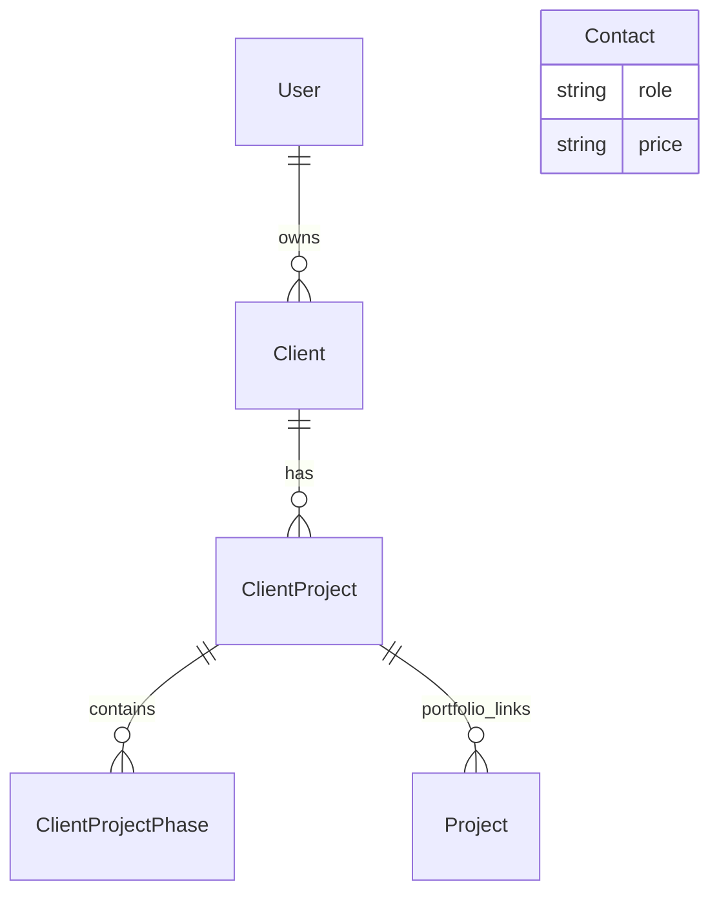

# Construction estimating and project system: database extension proposal

Status: proposed for review; not an applied schema or migration.
Date: 25 September 2026.
Basis: existing Prisma schema, SQL migrations, server actions and estimator/portal code; the user's `estimator instrustions.txt`.

Implementation note: the user subsequently required existing tables and data to remain unchanged. The first migration therefore creates independent new tables only; proposed legacy-table additions and relationship changes below are deferred. See [the foundation migration record](estimating-foundation-migration.md) for the implemented scope, refinements and validation.

## 1. Preservation contract

- Preserve every existing table, row, identifier, relationship, submission JSON, price string and uploaded-file reference.
- Keep the normal estimator's current submission flow. Its `priceEstimated` is a customer budget, not a calculated price; never import it as a financial baseline automatically.
- Keep `Project` as the public portfolio model. Keep `ClientProject` as the operational project model and `ClientProjectPhase` as its stages. Do not introduce a competing project/stage system.
- New premium submissions are separate records and do not create a `ClientProject` until a quote is accepted and converted.
- Old projects remain valid without quotes, premium submissions, tasks or financial baselines.
- Do not merge/delete existing duplicate clients or replace placeholder users. Future identity linking preserves their IDs.
- Price updates append price versions. Released estimates, quotes, variations and invoices retain their own immutable values.
- Archive records instead of deleting them. No reset, truncate, destructive reseed, table replacement or automatic file deletion is permitted by this plan.

## 2. Existing schema and migration uncertainty

The source schema has nine models: `User`, `Client`, `ClientProject`, `ClientProjectPhase`, `Project`, `Contact`, `Banner`, `BeforeAfter`, `HeroVideo`.

`Contact.role` describes trades, not access permissions. The existing `Category` enum is a portfolio category, not a construction catalogue hierarchy. Neither should be repurposed.

The checked-in migration history does not fully describe the checked-in schema: older IDs are TEXT in SQL but UUID in Prisma; nullability, defaults and timestamp precision also differ. Several migration-created indexes are absent from the Prisma model. The live database and applied migration history have not been queried. Therefore this proposal cannot establish the production baseline or authorize type conversions. Reconcile these differences using read-only inspection before generating executable migrations.

## 3. Shared conventions

These conventions apply to all new tables unless an exception is stated:

- `id`: UUID primary key, generated by the database; existing IDs retain their existing physical types. Foreign keys to existing tables use their verified physical types; `User` references are TEXT.
- Mutable tables: `createdAt`, `updatedAt` as timezone-aware timestamps, `createdByUserId?`, `updatedByUserId?`, and integer `revision` for optimistic concurrency.
- Archiveable business/configuration tables: nullable `archivedAt`, `archivedByUserId?`. Archived references remain readable in history and cannot be selected for new work.
- Append-only records: `createdAt`, actor where applicable, no general update/delete API. They are superseded by new records rather than archived out of financial history.
- Money: PostgreSQL `NUMERIC(19,4)` for unit costs/rates, `NUMERIC(19,2)` for GBP document totals; quantities and dimensions `NUMERIC(18,6)`; percentages `NUMERIC(7,4)`. Use decimal arithmetic throughout, never JavaScript floating-point arithmetic for money.
- Store ISO currency on each financial document/payment. Initial supported currency GBP; no implicit currency conversion. Unit rates retain four decimals; round each extended net line to pennies, then each line's VAT to pennies, using a versioned half-up policy. Totals sum rounded lines.
- Store net, VAT and gross separately. Preserve VAT treatment/code, rate, inclusive/exclusive flag, discounts, markup and rounding policy used at release.
- Dimensions use canonical metres, square metres and cubic metres. Unit conversion factors are explicit. No generic free-text formula evaluation.
- Foreign keys default to `ON DELETE RESTRICT` and `ON UPDATE RESTRICT`. Existing user IDs are no longer replaced. No cascaded destruction in new tables.
- Index all foreign keys used for joins; additional indexes and unique constraints below are explicit. PostgreSQL CHECK constraints and partial indexes may require custom SQL migrations alongside Prisma.
- JSON is permitted for versioned question answers, structured calculation rules and immutable snapshots. Operational tasks, money, approvals and relationships remain relational.
- This design assumes one construction company. `CompanySettings` is a singleton, not a claim of multi-tenant isolation.

## 4. Identity, access and existing-table additions

| Table | Proposed fields and relationships | Reason and constraints |
|---|---|---|
| `AuthIdentity` (new) | `userId -> User`, `provider`, `subject`, `verifiedEmailAt?` | Unique `(provider, subject)`; index `userId`. Resolve Kinde identities to a stable existing user ID. Never delete an old user on login. Linking requires authenticated, verified identity; duplicate email matches require explicit resolution. |
| `AccessRole` (new) | unique `code`, `name` | Initial codes ADMIN, ESTIMATOR, PROJECT_MANAGER, ACCOUNTS, WORKER. Client access derives from ownership and grants, not `Contact.role`. |
| `UserAccessRole` (new) | `userId -> User`, `roleId -> AccessRole` | Unique `(userId, roleId)`; revocation timestamp preserves grants. Only a reviewed admin assignment can confer access. |
| `ProjectAccessGrant` (new) | `userId -> User`, `clientProjectId -> ClientProject`, `scope`, `revokedAt?` | Unique `(userId, clientProjectId, scope)`; explicit assigned-project access. Does not grant access to all company finances. |
| `User` (extend) | nullable archive metadata | Keep current profile fields and IDs. Do not add unique email until duplicate analysis; email alone is not authorization. |
| `Client` (extend) | archive metadata | Preserve all existing contact/consent records. Future submissions reuse an authorized selected client; do not merge existing records by email automatically. |
| `ClientProject` (extend) | `lifecycleStatus?`, `acceptedQuoteVersionId? -> QuoteVersion`, `convertedAt?`, archive metadata | Nullable additions preserve old projects. Unique non-null accepted quote version prevents conversion twice. Keep old status/currentStage and price strings for compatibility. |
| `ClientProjectPhase` (extend) | `fixStage?`, `progressWeight?`, archive metadata | Reuse phases as construction stages. Keep jobs JSON, images and original IDs untouched. New tasks reference these phases. |
| `Project` (portfolio) | no required change in first migration | Retain `sourceClientProjectId`; later curated media links extend publishing without reuploading originals. |

The two-way quote/project relationship is deliberate: a quote can optionally concern an existing project, while the project's accepted-version field records its immutable baseline source. Conversion validates that these agree in a single transaction. An unrelated quote cannot be attached to another client's project.

Existing portal save code currently deletes/recreates phases. Before new task foreign keys or portal editing are enabled, replace this with updates by stable phase ID and explicit archival. Invalid phase JSON must reject the entire save, not become an empty list. Account linking and existing delete actions need equivalent preservation fixes before rollout.

## 5. Catalogue, suppliers and labour

| Table | Business fields / foreign keys | Constraints and use |
|---|---|---|
| `ItemCategory` | `parentId? -> ItemCategory`, `code`, `name`, `sortOrder` | Unique code; hierarchy supplies categories/subcategories without duplicate tables. Reject cycles. |
| `ItemUnit` | `code`, `label`, `dimensionKind`, `canonicalFactor?`, `quantityScale` | Unique code. Each, m, linear metre, m2, m3, room, point, hour, day, job, sheet, pack, bag, tonne, load, skip, fixture, opening. Pack conversions are item-specific. |
| `ConstructionItem` | `code`, `name`, `description`, `categoryId`, `unitId`, `itemType`, `itemRole`, `fixStage`, `defaultQuantity`, `defaultDurationHours?`, `defaultDimensions?`, `active` | Unique code; index category/active and normalized name for search. Types MATERIAL, LABOUR, PLANT, WASTE, PRELIMINARY, ASSEMBLY, OTHER; role MAIN/SUPPORTING/BOTH. |
| `ItemPriceVersion` | `itemId`, `versionNumber`, `materialUnitCost`, `labourUnitCost?`, `plantUnitCost`, `wasteUnitCost`, `otherUnitCost`, `currency`, `taxCodeId?`, `effectiveFrom`, `supersedesId?`, `source`, `sourceDate?`, `confidence`, `notes` | Append-only; unique `(itemId, versionNumber)` and `(itemId, currency, effectiveFrom)`; index effective date. Null labour cost means derive from labour recipes, otherwise it is the explicit override: never sum both. Effective end is derived from the next version. Corrections append, never rewrite. |
| `ItemOption` | `itemId`, `groupCode`, `code`, `label`, `sortOrder`, `active` | Unique `(itemId, groupCode, code)`; customer choices such as style/finish. |
| `ItemOptionVersion` | `optionId`, `versionNumber`, `effectiveFrom`, `rule`, `specification`, `sourcePriceVersionId?` | Append-only; unique option/version and option/effective date. Rule defines validated quantity/cost adjustments or substitution, with schema version. |
| `ItemRecipeVersion` | `itemId`, `versionNumber`, `condition`, `effectiveFrom`, `quantityRule`, `assumptions` | Append-only; unique item/condition/version and item/condition/effective date. Freeze recipes so calculations can be reproduced. |
| `ItemSupportingItem` | `recipeVersionId`, `supportingItemId`, `quantityRule`, `mandatory`, `defaultSelected`, `costBucket` | Unique recipe/supporting item; prohibit cycles across recipe expansion, cap depth. Costs roll up once into the parent or display as separate lines, never both. |
| `LabourRole` | `code`, `name` | Unique code; separate from access roles and worker identity. |
| `LabourRateVersion` | `labourRoleId`, `versionNumber`, `hourlyCost`, `dailyCost?`, `productiveHoursPerDay`, `defaultTeamSize`, `currency`, `effectiveFrom`, `source`, `notes` | Append-only; unique role/version and role/currency/effective date. Explicit basis chooses hourly or daily calculation. |
| `ItemLabour` | `recipeVersionId`, `labourRoleId`, `hoursPerUnit`, `teamSize`, `rateBasis` | Unique recipe/role; labour effort recorded as person-hours, distinct from elapsed duration. |
| `Supplier` | `code`, `name`, contact fields, `website?`, `contactId? -> Contact` | Unique code; optional link reuses an existing directory entry. |
| `SupplierPriceReference` | `supplierId`, `itemId`, `supplierCode?`, `sourceUrl?`, `referencePrice`, `currency`, `unitId`, `packQuantity?`, `taxInclusive`, `checkedAt`, `notes` | Append-only observations; index item/supplier/checkedAt. References inform reviewed prices, never change customer totals automatically. |
| `TaxCode` | unique `code`, `label`, `active` | Configurable VAT classification. Financial lines snapshot the actual rate and treatment. |
| `TaxRateVersion` | `taxCodeId`, `rate`, `effectiveFrom`, `reason` | Append-only; unique tax code/effective date. Rates are business configuration, not legal eligibility decisions. |

`ItemPriceVersion` is the price history; a second price-history table is unnecessary. Standard/premium/custom options and work conditions use versioned recipes/options rather than hundreds of nearly identical items. Supplied-by CLIENT or EXISTING can zero the relevant material charge while retaining labour; the selected rule is snapshotted.

## 6. Premium submissions and calculation snapshots

| Table | Business fields / foreign keys | Constraints and use |
|---|---|---|
| `EstimatorDefinitionVersion` | `versionNumber`, question/rule schema JSON, `publishedAt?` | Published definitions immutable; unique version. Answers reference the exact question definition. |
| `EstimateSubmission` | `clientId`, `definitionVersionId`, `status`, `answers`, property/project summary, `submittedAt?`, `idempotencyKey` | Unique idempotency key; index client/status/createdAt. Draft answers editable; submitted answers frozen. Premium only initially. |
| `EstimateRequirement` | `submissionId`, `sectionKey`, `description`, `kind`, `reviewStatus`, `reviewedByUserId?`, `reviewNotes?` | Explicit unpriced special requests and uncertainties. Manual review is not silently priced at zero. |
| `EstimateOrder` | unique `submissionId`, `feeNet`, `feeVatRate`, `feeVat`, `feeGross`, `feeTaxInclusive`, `currency`, `status`, `settingsVersionId` | Freeze configured £50 fee and whether inclusive/exclusive before checkout. Payment events, not browser redirects, establish paid status. |
| `EstimateCalculation` | `submissionId`, `versionNumber`, `engineVersion`, `settingsVersionId`, `inputHash`, `currency`, `totalsSnapshot`, `assumptions`, `createdAt` | Append-only; unique submission/version. Includes cost buckets, markup, VAT, totals, review flags and duration. Order must be settled before generation. |
| `EstimateCalculationLine` | `calculationId`, `lineNumber`, `itemId?`, `priceVersionId?`, `recipeVersionId?`, `snapshot` | Append-only; unique calculation/lineNumber. Snapshot includes name, description, unit, quantity, dimensions, options, resolved supporting items, labour/rates/hours, source versions and all monetary values. |

Resolved supporting components and option snapshots are nested within the immutable line snapshot; do not also count them as independent payable lines. Engine validation explicitly rejects ambiguous double counting, invalid dimensions, missing prices and dependency cycles. Each result stores its input, configuration and engine version for reproducibility.

## 7. Quotes, revisions, approval and conversion

| Table | Business fields / foreign keys | Constraints and use |
|---|---|---|
| `Quote` | unique `number`, `clientId`, `sourceCalculationId?`, `clientProjectId?`, `currentVersionNumber`, `status` | Mutable aggregate; index client/status/date. Current version resolves through unique quote/version, avoiding cross-quote pointer mistakes. |
| `QuoteVersion` | `quoteId`, `versionNumber`, `state`, `currency`, `customerSnapshot`, `siteSnapshot`, `settingsVersionId`, `validUntil`, `programmeText`, assumptions, exclusions, net/VAT/gross totals, `releasedAt?`, `contentHash?` | Unique quote/version. Draft can change with optimistic locking; release freezes the complete version. Any later amendment creates a new version. |
| `QuoteSection` | `quoteVersionId`, `parentId?`, `kind`, `title`, `sortOrder` | Same-version parent constraint; kind STAGE/ROOM/GENERAL. Reject cycles. |
| `QuoteLine` | `quoteVersionId`, `stageSectionId?`, `roomSectionId?`, `itemId?`, `priceVersionId?`, `sourceCalculationLineId?`, `lineNumber`, name/description/unit snapshots, quantity/dimensions, `supplyBy`, `lineKind`, specification/options/components snapshot, separate internal costs, labour hours, unit selling price, discount, markup, tax code/rate/net/VAT/gross | Unique version/lineNumber. Stage and room are independent groupings. MANUAL, FIXED, ALLOWANCE, PROVISIONAL, OPTIONAL lines explicit. Excluded lines do not contribute to payable totals. |
| `QuoteApproval` | `quoteVersionId`, `actorUserId`, `decision`, `decidedAt`, `documentHash`, `ipAddress?`, `userAgent?`, `idempotencyKey` | Append-only; unique idempotency key. Accepted approval unique per version. Require client ownership, released/current/unexpired version and explicit total. |
| `QuoteApprovalOption` | `approvalId`, `quoteLineId` | Unique approval/line; records selected optional lines from that exact version. Optional totals shown separately until selection. |
| `ProjectBaseline` | unique `clientProjectId`, unique `quoteApprovalId`, `currency`, approved cost/sell/tax totals, approved programme snapshot | Append-only original baseline; variations adjust scope separately. Legacy projects may have no baseline. |

Release/approval immutability must be enforced across the version and its child sections/lines, using database triggers in addition to service checks. A change to a live catalogue price must have no effect on released documents.

Conversion runs in one transaction with locks and unique constraints: verify accepted current version/approval, reuse its client, create or deliberately link an authorized existing project, populate baseline/stages/rooms/tasks/material/labour requirements from approved lines and chosen options, and set `acceptedQuoteVersionId`. A retry returns the original project. Declined/unselected options and unpriced requirements cannot silently become contracted scope.

## 8. Project scope, scheduling, people and actual costs

| Table | Business fields / foreign keys | Constraints and use |
|---|---|---|
| `ProjectScopeVersion` | `clientProjectId`, `versionNumber`, `baselineId?`, `variationVersionId?`, scope/assumptions/exclusions snapshot, `releasedAt?` | Unique project/version; released scope immutable. Exactly one source when generated from a financial approval. |
| `ProjectRoom` | `clientProjectId`, `code`, `name`, floor, dimensions | Unique project/code; preserve rooms through archive. |
| `ProjectTask` | `clientProjectId`, `phaseId`, `roomId?`, `sourceQuoteLineId?`, `sourceVariationLineId?`, title, description, status, quantity/unit, estimated person-hours, elapsed duration, progress weight, planned/actual dates | Index project/status and phase/order. Every linked phase/room must belong to the same project. Actual progress from tasks can coexist with legacy manual progress; explicit mode selects the authority. |
| `TaskDependency` | `predecessorId`, `successorId`, `dependencyType`, `lagHours` | Unique edge/type; no self links, cross-project links or graph cycles. |
| `ProjectMaterialRequirement` | `clientProjectId`, `taskId?`, `itemId?`, approved-line reference, name/unit snapshot, required quantity, supplyBy, estimated unit/total cost | Planned quantities/costs independent of purchases. Never reprice historical requirements from the catalogue. |
| `ProjectLabourRequirement` | `clientProjectId`, `taskId?`, `labourRoleId`, approved-line reference, planned person-hours, team size, rate/cost snapshot | Estimated labour independent of actual time. |
| `Worker` | `userId?`, `contactId?`, name/contact fields, `labourRoleId`, `employmentType`, active | Unique non-null userId; reuse contact directory where appropriate. No automatic access grant. |
| `WorkerRateVersion` | `workerId`, currency, hourly/daily cost, effectiveFrom | Append-only; unique worker/currency/effective date. Restricted to authorized financial staff. |
| `WorkerAssignment` | `workerId`, `clientProjectId`, `phaseId?`, `taskId?`, start/end dates, allocation | Validate all scope references belong to project; index worker/date and project/date. |
| `TimeEntry` | `workerId`, `clientProjectId`, `taskId?`, start/end, break minutes, worked hours, `workerRateVersionId`, cost snapshot, status, approver | Require positive duration and valid breaks; detect overlapping approved time. Approval freezes cost; corrections append adjusting entries. |
| `ProjectTemplate` | unique code, name, active | Stable template identity. |
| `ProjectTemplateVersion` | `templateId`, versionNumber, publishedAt | Unique template/version; published version immutable. |
| `TemplatePhase` | `templateVersionId`, code, title, order, fixStage, weight | Unique template version/code. |
| `TemplateTask` | `templatePhaseId`, code, title, role/item references, quantity/duration rules | Unique phase/code; template snapshot copied at project creation. |
| `TemplateTaskDependency` | predecessor/successor template task, type, lag | Same template version only; acyclic graph. |

Task scheduling considers dependencies, working calendars, team availability and overlap. Summed labour effort is not a completion date. Calendar configuration is versioned in company settings; later overrides can be added without changing stored historical programmes.

## 9. Variations, snagging, files and portfolio

| Table | Business fields / foreign keys | Constraints and use |
|---|---|---|
| `Variation` | `clientProjectId`, project-local number, requestedBy, status | Unique project/number. |
| `VariationVersion` | `variationId`, versionNumber, reason, scope/schedule impact, currency, signed net/VAT/gross adjustment, releasedAt, contentHash | Unique variation/version; released data immutable. Supports additional costs and credits. |
| `VariationLine` | `variationVersionId`, lineNumber, original quote/task reference?, item reference?, signed quantity, full specification/cost/sell/tax snapshot | Unique version/lineNumber; delta against approved scope, not a rewrite of original quote. |
| `VariationApproval` | `variationVersionId`, actor, decision, timestamp, documentHash, IP?, idempotencyKey | Append-only; unique idempotency key and accepted decision per version. Approval atomically creates one scope revision; rejected variations never affect committed totals. |
| `Snag` | `clientProjectId`, room/task?, description, priority, status, assignedWorkerId?, reportedBy, completedAt?, verifiedAt? | Index project/status; client-visible status independent from internal notes. |
| `MediaAsset` | unique provider/fileKey, URL, original name, MIME type, size, checksum?, uploadedBy?, clientId?, visibility, caption, takenAt?, tag, favourite, portfolioCandidate | Keep existing files and URLs; no deletion policy is implied. Visibility PRIVATE/CLIENT/PUBLIC. Public access requires publication approval. |
| `MediaDerivative` | `assetId`, kind, fileKey, URL, width/height, size | Unique asset/kind; thumbnails/optimized images preserve original. |
| `ProjectMedia` | `assetId`, `clientProjectId`, phase/room/task/snag optional links | Unique project/asset; enforce same-project references. |
| `SubmissionMedia` | `assetId`, `submissionId` | Unique submission/asset; verify ownership rather than trusting a submitted URL. |
| `PortfolioMedia` | `assetId`, `portfolioProjectId -> Project`, sortOrder, isCover | Unique portfolio/asset; partial unique cover per portfolio. Publishing does not automatically expose private original media. |
| `Document` | clientId, projectId?, type, title, visibility | Logical document identity; index client/project/type. |
| `DocumentVersion` | documentId, versionNumber, assetId, sourceQuoteVersionId?, sourceVariationVersionId?, sourceInvoiceId?, sourceScopeVersionId?, contentHash | Append-only; unique document/version. Exactly one source where applicable; immutable PDF/web version represents the released snapshot. |
| `DocumentDelivery` | documentVersionId, recipient, channel, status, attemptedAt, deliveredAt?, providerReference?, errorCode? | Append-only attempts; does not imply permission to email during development. |

Project photos need server-side ownership checks and protected delivery for private documents; a secret-looking public URL is not access control. Existing URL arrays/JSON remain readable until explicit, verified media-link backfill is complete.

## 10. Invoices, payments, expenses and accounting

| Table | Business fields / foreign keys | Constraints and use |
|---|---|---|
| `Invoice` | unique number, clientId, projectId?, phaseId?, documentKind INVOICE/CREDIT_NOTE, creditedInvoiceId?, currency, customer/address snapshot, issue/due dates, state, net/VAT/gross, issuedAt?, contentHash | Draft editable; issued financial fields immutable. Correct with credit note/replacement. Phase completion creates a draft only, subject to configured approval. |
| `InvoiceLine` | invoiceId, lineNumber, quoteLineId?/variationLineId?, description/unit/quantity/unit-price/discount/tax snapshots, net/VAT/gross | Unique invoice/lineNumber; source references informational, values independent. Partial/stage billing uses an explicit allocation policy to avoid billing scope twice. |
| `Payment` | clientId, estimateOrderId?, provider, providerPaymentId?, direction RECEIPT/REFUND, originalPaymentId?, amount, currency, method, reference, state, settledAt?, idempotencyKey | Unique provider/payment ID when non-null; unique idempotency key. Refund is a new record. Estimate fee payment never counts as project payment automatically. |
| `PaymentAllocation` | paymentId, invoiceId, amount, allocatedAt, idempotencyKey | Append-only; unique idempotency key. Lock invoices/payments to prevent over-allocation; currency/client must match. Credit/refund allocations reverse explicitly. |
| `PaymentEvent` | provider, eventId, paymentId?, receivedAt, processedAt?, sanitized event metadata, processing state | Unique provider/eventId. Signature verification and idempotent processing prevent duplicate settlement/conversion. No card data stored. |
| `Expense` | projectId?, supplierId?, workerId?, category, incurredAt, reference, currency, state, net/VAT/gross, receiptDocumentId? | Purchase/expense header; prevent duplicate supplier invoice references where available. Posted entries immutable. |
| `ExpenseLine` | expenseId, projectId?, taskId?, materialRequirementId?, itemId?, description, quantity/unit, net/tax/gross, costType | Separate materials, labour, plant, waste and other costs. Index project/date through header/line; supports one bill covering multiple projects. |
| `ExpensePayment` | expenseId, amount, currency, method, paidAt, reference, direction, originalPaymentId?, idempotencyKey | Append-only outgoing settlement/refunds; unique idempotency key. Outstanding expense balance derived. |
| `LedgerAccount` | unique code, name, type, active | ASSET/LIABILITY/EQUITY/INCOME/EXPENSE. Mapping is configured and reviewed. |
| `JournalEntry` | unique postingKey, postedAt, description, currency, invoiceId?/paymentId?/expenseId?/expensePaymentId?, reversalOfId? | Immutable once posted; source-specific FKs and exactly one source, except explicitly approved manual journals. |
| `JournalLine` | journalEntryId, accountId, projectId?, debit, credit | One nonzero side per line; all lines balance per entry/currency in posting transaction, enforced by deferred database validation. |

Invoice/payment outstanding balances are derived from allocations, credits and refunds, not editable status switches. Pending/failed payments contribute nothing. One settlement may fund multiple invoices; an invoice may receive multiple partial payments.

Labour time represents incurred cost; worker payments settle that liability and must not count as a second labour expense. Materials cost is derived from posted purchase lines, not both purchases and cash payments. Project profitability distinguishes committed revenue, invoiced revenue, received cash, estimated costs and actual costs. Chart-of-accounts and VAT eligibility require business/accounting review before financial rollout; no statutory reporting claim is made here.

## 11. Settings, notifications and audit

| Table | Business fields / foreign keys | Constraints and use |
|---|---|---|
| `CompanySettings` | singleton key, currentVersionNumber | One company configuration identity. |
| `CompanySettingsVersion` | settingsId, versionNumber, currency, estimator fee amount/inclusive flag/tax code, default markup, waste, contingency, default workday/team/calendar, quote validity, invoice terms, invoice generate/send flags, roundingPolicyVersion | Append-only; unique settings/version. Default premium fee £50 but VAT basis must be explicitly configured before checkout. |
| `Notification` | recipientUserId, projectId?, type, safe payload, createdAt, readAt? | Index recipient/readAt/date; payload excludes internal prices for client notifications. |
| `OutboxEvent` | unique eventKey, type, aggregate reference, minimal payload, state, attempts, nextAttemptAt | Inserted in same transaction as business event, processed after commit. Prevents lost notifications from fire-and-forget sends. |
| `NotificationDelivery` | notificationId, channel, attempt, state, providerReference?, sentAt?, errorCode? | Unique notification/channel/attempt; retries use provider idempotency where supported. |
| `AuditEvent` | actorUserId?, actorKind, action, entityType/entityId, before/after redacted JSON, reason?, occurredAt, correlationId | Append-only; index entity/date and actor/date. Entity reference is intentionally generic and survives archival. Never log secrets/card data. |

An audit event records price creation, overrides, quote release/approval, conversion, variation decisions, document issuance, payment posting, access grants and archival. New financial mutations and their audit records commit together. No historical audit entries are invented for old data.

## 12. State machines and invariants

- Fix stage: FIRST_FIX, SECOND_FIX, BOTH, NOT_APPLICABLE.
- Work condition: NEW_BUILD, NEW_INSTALLATION, REFURBISHMENT, REPAIR, MAKE_GOOD, REDECORATION.
- Supplied by: CONTRACTOR, CLIENT, EXISTING.
- Submission: DRAFT, PAYMENT_REQUIRED, PAID, CALCULATING, CALCULATED, REQUIRES_REVIEW, CANCELLED. Quote lifecycle lives on Quote, avoiding conflicting copies of quote acceptance on the submission.
- Order/payment: PENDING, PROCESSING, SUCCEEDED, FAILED, CANCELLED; aggregate order may become PARTIALLY_REFUNDED/REFUNDED based on refund records.
- Quote: DRAFT, INTERNAL_REVIEW, SENT, VIEWED, CHANGES_REQUESTED, ACCEPTED, DECLINED, EXPIRED, SUPERSEDED. Transition checks lock the quote and verify the exact version.
- Extended project lifecycle: LEAD, ESTIMATING, QUOTED, AWAITING_APPROVAL, APPROVED, PREPARATION, IN_PROGRESS, ON_HOLD, SNAGGING, COMPLETED, CANCELLED. Legacy enums remain in place; a compatibility mapping is explicit and never silently overwrites old statuses.
- Task: PLANNED, READY, IN_PROGRESS, BLOCKED, COMPLETED, CANCELLED.
- Variation: DRAFT, INTERNAL_REVIEW, SENT, APPROVED, DECLINED, SUPERSEDED.
- Snag: OPEN, ASSIGNED, IN_PROGRESS, COMPLETED, VERIFIED.
- Invoice issuance: DRAFT, ISSUED, VOID; payment/overdue state derived separately. Issued monetary corrections use credits, not field edits.

Checks: positive normal quantities and conversion factors; nonnegative costs; positive payments; percentage ranges appropriate to each field (VAT/discount 0–100; markup may exceed 100); start <= end; exactly one applicable source for baseline/adjustments; same-client financial allocations; same-project phase/room/task/media relationships; same-version quote section/approval-option links. Composite foreign keys enforce ownership where practical; remaining cross-row rules use transaction locks and database triggers. Generic foreign-key existence alone is insufficient.

Unique numbering uses a database sequence or locked sequence row, not `count + 1`. Archived numbers are never reused. Every mutation checks a current revision so two administrators cannot silently overwrite each other.

## 13. Server-side visibility and authorization

All server actions, route handlers, document downloads and uploads require their own checks. Dashboard layout checks do not secure mutations.

| Audience | Allowed access |
|---|---|
| Public | Published portfolio and public website assets only. Normal estimator submission stays public, with validation and abuse limits. |
| Client | Own visible projects and released customer documents; own approvals and payments. Explicit response projections exclude internal costs, wages, supplier references, markup, margin and internal notes. |
| Worker | Assigned projects/tasks and permitted time entries; no general client accounting or other workers' rates. |
| Estimator / manager | Permissions appropriate to estimating/project work; private financial fields only when explicitly granted. |
| Accounts / admin | Authorized financial/admin operations with audit history. |

Never spread full Prisma records into client payloads. Project ownership must be checked even when a caller knows a valid UUID. Approval resolves ownership from the authenticated identity, not email or a supplied client ID. Optional anonymous premium checkout would need a separate verified claim/access-token design; the initial premium design requires an identified client account.

## 14. Implementation batches and migration safety

These are future implementation steps, not operations executed by this document.

1. **Read-only baseline:** inspect actual tables/types/defaults/indexes/constraints and `_prisma_migrations`; record counts and duplicate identities; confirm target database. Do not print connection secrets or customer data. Preserve existing migration files.
2. **Recoverability:** create a verified database backup and file-reference inventory, restore into an isolated test database, and compare counts/checksums. Review restores before any production schema change.
3. **Schema reconciliation:** represent the actual existing baseline without altering IDs or rewriting rows. Do not run `db push`, reset migrations or replay historical SQL blindly. Existing TEXT/UUID differences require an explicit plan based on real values, never guessed casts.
4. **Preservation/security fixes:** stable phase updates and archive actions; non-destructive identity linking; centralized mutation authorization; published-only public project queries. Ship and validate compatibility before enabling new relations/features. Keep this separate from catalogue UI work.
5. **Foundation migration:** new catalogue, price/recipe/labour/tax/settings tables and audit support; nullable archive fields only on existing tables. No catalogue pricing invented or imported automatically.
6. **Premium and quote migrations:** identity/permissions, definitions/submissions/orders, payment events, calculation snapshots, quote versions/approvals. Feature flags keep premium disabled until paid-state and authorization tests pass.
7. **Project migrations:** nullable accepted-quote link, baseline, rooms/tasks/requirements/templates/workers. Resolve the quote/project FK cycle by creating tables before adding nullable FKs. Preserve legacy project behaviour.
8. **Operations/finance migrations:** variations, snagging, documents/media, invoices/expenses/ledger and notifications in independently reviewable batches. Do not build all modules in one migration.
9. **Constraints:** validate against restored real data; add FK/check constraints with staged validation where appropriate. Use additive indexes; concurrent production indexes require an explicit non-transactional migration strategy.
10. **Legacy cascade protection:** after all delete callers have been changed, replace User→Client, Client→ClientProject and ClientProject→Phase delete cascades with RESTRICT in a dedicated reviewed migration. Rows/links remain unchanged. Current portfolio SET NULL is left intact initially; project deletion is disabled by application policy.
11. **Optional backfill:** new mappings/media links only, batched and idempotent with source IDs/checkpoints. Leave JSON, images arrays, prices, users and duplicate clients intact. No automatic task inference or price conversion from legacy text.
12. **Verification:** compare original IDs, counts, legacy-column checksums and references before/after each batch under a controlled write window; verify backups/restore and migration status. Investigate any unexpected difference before enabling features.

Rollback is primarily application rollback/feature disable with additive tables retained. Never drop new tables once they contain real business records. A failed transactional migration rolls back its own uncommitted DDL; partial non-transactional work needs a forward repair. Backup restoration is a coordinated recovery procedure that reconciles writes after the backup, not an automatic rollback that discards new customer data.

## 15. Validation required before implementation is considered complete

- Existing estimator submission, public website, admin edits, account login and portal access remain compatible on a restored test database.
- Existing phase IDs/jobs/photos remain unchanged after a portal edit; invalid payloads cannot clear phases.
- Migration tests preserve all original IDs and data; no cascading deletions are exercised on production.
- Calculator tests cover dimensions/units, options, supporting-item recursion, client supply, labour override versus derived rates, allowances/provisional/optional lines, rounding, VAT, discounts and mixed VAT rates.
- Changing catalogue/recipe/tax/settings versions cannot alter released calculations, quotes, scope or invoices.
- Duplicate webhooks/conversion requests and concurrent approvals create at most one settlement/baseline/project.
- Released versions/children cannot be mutated through direct database writes by the application role.
- Client A cannot fetch Client B's project, media, quote or invoice; clients cannot obtain internal financial fields through API manipulation.
- Payments, refunds, partial allocations, expense settlement and journal reversals preserve balanced accounts and prevent double-counting actual costs.
- Build success is insufficient while TypeScript/lint errors are ignored. Establish explicit passing type/lint checks and meaningful isolated tests before rollout.

## 16. Decisions at the design checkpoint

Recommended defaults: retain existing model names; additive migrations; stable user/phase IDs; archive instead of delete; logged-in premium flow; GBP initially; immutable released versions; admin review before sending invoices; no production migration until backup restoration and baseline checks succeed.

Business configuration required before payment/financial activation: whether £50 includes VAT, applicable VAT treatment, approved catalogue prices/labour rates, markup, quote terms and accounting mappings. These do not block catalogue schema review.

The next stage after this design is reviewed is migration implementation for the approved first batch. This proposal does not alter `schema.prisma`, generate migration SQL, run database commands, modify application behaviour, send email or collect payments.
